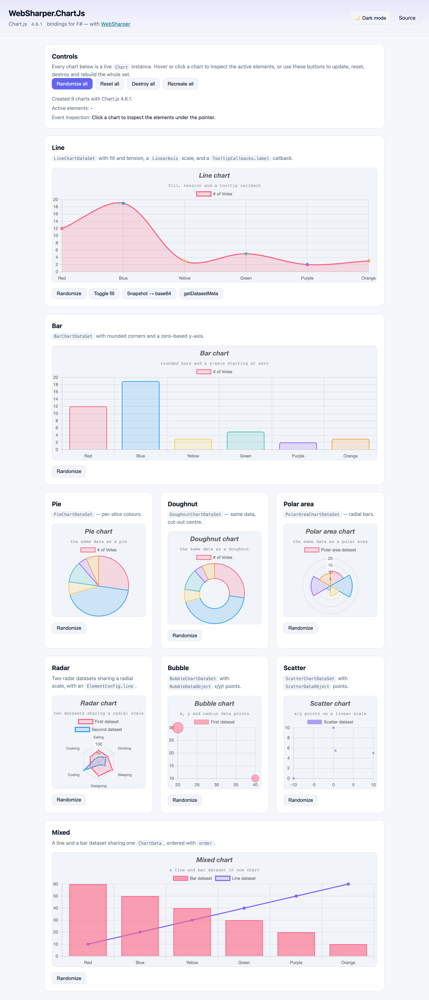

# WebSharper.ChartJs

[](https://www.nuget.org/packages/WebSharper.ChartJs)

WebSharper bindings for [Chart.js](https://www.chartjs.org/) 4 — line, bar, pie,
doughnut, polar-area, radar, bubble, scatter and mixed charts for F# and C# web
apps.

The binding consumes the npm package [`chart.js`](https://www.npmjs.com/package/chart.js)
as an ES module (`import { Chart } from "chart.js/auto"`) and is bundled by your
toolchain (esbuild in the sample); there is no CDN `<script>` tag.

This repository contains:

| Project | Purpose |
| --- | --- |
| `WebSharper.ChartJs` | The binding: WIG definitions for `Chart`, the per-type data-set classes, the option objects (axes, scales, plugins, legend, tooltip, animation) and the supporting enums. |
| `WebSharper.ChartJs.Sample` | A WebSharper SPA (esbuild → `dist/`) that renders one chart of every type and exercises the options and the `Chart` lifecycle/inspection API. |

## Live demos

**Try it live:** [Open the sample in your browser](https://dotnet-websharper.github.io/chartjs/)



The sample doubles as the binding's [test case](#running-the-test-case): it
creates all nine chart types, randomizes and resets their data, toggles the line
chart's fill, reads `getDatasetMeta`, captures a `toBase64Image()` PNG and
inspects hovered/clicked elements. It is light-themed by default and has a
light/dark theme switcher (persisted in `localStorage`).

- **Sample (this repository):** <https://dotnet-websharper.github.io/chartjs/>
- **Source repository:** <https://github.com/dotnet-websharper/chartjs>
- **WebSharper bindings:** <https://websharper.com/bindings>

## Install

```bash
dotnet add package WebSharper.ChartJs
```

Or with Paket:

```fsharp
nuget WebSharper.ChartJs
```

The package targets `netstandard2.0`. It supports Chart.js
`>= 4.6.1 < 5.0.0` (the 4.x line); Chart.js itself is pulled from npm
(`chart.js`), so the JS bundle step must resolve it (WebSharper's SPA/esbuild
build does this automatically).

## Usage

All types live in the `WebSharper.ChartJs` namespace. A chart is created with
`Chart(canvas, config)`; the config is a `ChartCreate` holding a `ChartData` and
an `Options`.

### A line chart

```fsharp
open WebSharper
open WebSharper.JavaScript
open WebSharper.ChartJs

[<JavaScript>]
let LineChart () =
    let dataSet = LineChartDataSet()
    dataSet.Label <- "# of Votes"
    dataSet.Data <- [| 12; 19; 3; 5; 2; 3 |]
    dataSet.BackgroundColor <- Union2Of2 [| "rgba(255,99,132,0.2)" |]
    dataSet.BorderColor <- Union2Of2 [| "rgba(255,99,132,1)" |]
    dataSet.Fill <- Union1Of2 true
    dataSet.Tension <- 0.35
    dataSet.BorderWidth <- 3

    let data = ChartData()
    data.Datasets <- [| dataSet |]
    data.Labels <- [| "Red"; "Blue"; "Yellow"; "Green"; "Purple"; "Orange" |]

    let options = Options()
    options.MaintainAspectRatio <- false
    options.Scales <- New [ ("y", box (LinearAxis(BeginAtZero = true))) ]

    let config = ChartCreate(data, options)
    Chart("line", config)
```

`Chart` takes a canvas element or an element id (the `?elementId` inline
resolves a string with `document.getElementById`). The `Data` property accepts a
number array; the colour properties accept a single colour or a per-point array.

### Titles, legends and plugins

```fsharp
let options = Options()
options.Plugins <-
    Plugin(
        Title = TitleConfig(
            Display = true,
            Text = Union1Of2 "Line chart",
            Font = Font(Size = 18, Style = FontStyle.Italic)
        ),
        Legend = LegendConfig(Display = true, Position = PositionString.Top),
        Tooltip = TooltipConfig(Mode = TooltipModes.Index, Intersect = false)
    )
```

`Plugin` also carries `Subtitle`, `Decimation` and a `Tooltip` whose
`Callbacks` (`TooltipCallbacks`) exposes the Chart.js callback surface as
`System.Func`/`System.Action` values.

### Mixed charts and per-type data sets

Every chart type has its own data-set class (`LineChartDataSet`,
`BarChartDataSet`, `PieChartDataSet`, `DoughnutChartDataSet`,
`PolarAreaChartDataSet`, `RadarChartDataSet`, `BubbleChartDataSet`,
`ScatterChartDataSet`). Each one injects its Chart.js `type`, so you can mix
them in one `ChartData`:

```fsharp
let data = ChartData()
data.Datasets <- [| lineDataSet; barDataSet |]   // mixed line + bar
data.Labels <- [| "January"; "February"; "March" |]
```

### Lifecycle and inspection

```fsharp
let chart = Chart("line", config)

chart.Update()
chart.Reset()
chart.Resize()
chart.ToBase64Image()          // -> "data:image/png;base64,..."
chart.GetDatasetMeta(0)        // metadata for one data set
chart.GetElementsAtEventForMode ev, InteractionMode.Index, Interaction(Intersect = false), false
chart.Destroy()
```

`Chart.Version` reports the loaded Chart.js version, and `Chart.Defaults` is the
global defaults object. Hover/click callbacks (`Options.OnHover`,
`Options.OnClick`) receive the native event plus an `ActiveElement[]`.

## Notes on the API

- **The package is npm-based.** The binding imports `Chart` from
  `chart.js/auto`, which registers every controller, scale, element and plugin.
  Nothing is fetched from a CDN; add `chart.js` to your front-end dependencies
  (WebSharper registers it as an `NpmDependencies` entry).
- **Options are passed to `ChartCreate`.** `ChartCreate(data, options)` builds
  the `{ data, options }` config; pass an `Options()` (with defaults) when you
  do not need any customisation.
- **Union-typed members use `Union1Of2` / `Union2Of2`.** Chart.js accepts a
  scalar *or* an array for many properties (`backgroundColor`, `borderColor`,
  `data`, `padding`, …). In F#, wrap the value in the matching case, e.g.
  `Union2Of2 bgColors` for a `string[]`.
- **Callbacks are delegates.** WIG maps `^->` to `System.Func`/`System.Action`,
  so a tooltip `label` callback is
  `System.Func<TooltipItem, obj, string array>` and `OnClick` is
  `System.Action<Dom.Event, ActiveElement[]>`.
- **Options use named arguments.** The optional fields are settable properties,
  so `Font(Size = 18, Style = FontStyle.Italic)` and
  `TitleConfig(Display = true, Text = Union1Of2 "…")` both work.
- **Chart.js 4 no longer has `Chart.Line(...)`.** Construct charts with
  `Chart(canvas, config)`; the per-type data-set classes supply the chart type.
- **Event inspection uses `getElementsAtEventForMode`.** Chart.js 4 removed the
  legacy `getElementAtEvent` / `getElementsAtEvent` / `getDatasetAtEvent`
  helpers. Use `GetElementsAtEventForMode(event, mode, Interaction(...),
  useFinalPosition)` for a manual lookup, or the typed `Options.OnHover` /
  `Options.OnClick` callbacks, which already receive the `ActiveElement[]`.

## Running the test case

The sample is a static SPA. Building it runs `npm install` and esbuild and emits
`dist/` at the repository root:

```bash
dotnet build WebSharper.ChartJs.Sample/WebSharper.ChartJs.Sample.fsproj -c Release
dotnet serve -d dist -p 8080
```

`dotnet serve` comes from the [`dotnet-serve`](https://github.com/dotnet-serve/dotnet-serve)
tool; install it once with `dotnet tool install -g dotnet-serve` (or use
`dotnet tool run dotnet-serve` with a local tool manifest).

Open <http://localhost:8080/>. Chart.js is fully bundled, so no network access
is needed. The buttons drive the whole binding — use them to verify a change end
to end.

## Building from source

### Prerequisites

- [.NET SDK 10](https://dotnet.microsoft.com/download) or later (the WebSharper
  11 compiler used by the default branch needs the .NET 11 runtime).
- [Node.js](https://nodejs.org/) (for the sample's esbuild step).
- [Paket](https://fsprojects.github.io/Paket/) as a local dotnet tool (configured
  in `.config/dotnet-tools.json`).

### Restore and build

```bash
dotnet tool restore
dotnet paket restore
dotnet build WebSharper.ChartJs.sln -c Release
```

The binding targets `netstandard2.0`; the sample is a static bundle. `./build
<target>` runs the same steps through the shared build script (e.g. `./build
CI-Release`).

### Pack the NuGet package

After a Release build (so the assembly exists in `bin/Release/netstandard2.0`):

```bash
dotnet paket pack ./out
```

## Deployment

Pushing to the default branch (`master`) triggers
`.github/workflows/ghpages.yml`, which builds the sample in Release and publishes
`dist/` to the `gh-pages` branch via GitHub Pages.

## Repository layout

```
WebSharper.ChartJs/              # the binding (WIG definitions)
  Main.fs
WebSharper.ChartJs.Sample/       # static SPA demo / test case
  Client.fs
  index.html
  site.css
  esbuild.config.mjs
  wsconfig.json
docs/
  sample.png                     # screenshot of the running sample
nuget/                           # Paket pack template
.github/workflows/ghpages.yml    # build + deploy the sample
```

## License

Apache 2.0 — see [LICENSE.md](LICENSE.md).
